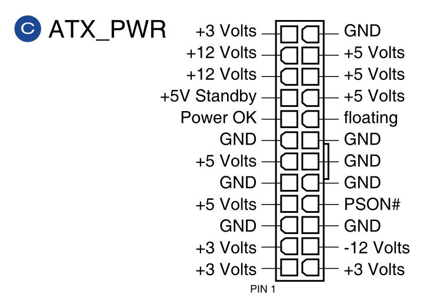

# ATX 电源

## 24-pin Main Power Connector

- Pin 1: +3.3V DC Orange
- Pin 2: +3.3V DC Orange
- Pin 3: COM Black
- Pin 4: +5V DC Red
- Pin 5: COM Black
- Pin 6: +5V DC Red
- Pin 7: COM Black
- Pin 8: PWR_OK Gray
- Pin 9: +5VSB Purple
- Pin 10: +12V1 DC Yellow
- Pin 11: +12V1 DC Yellow
- Pin 12: +3.3V DC Orange
- Pin 13: +3.3V DC Orange
- Pin 14: -12V DC Blue
- Pin 15: COM Black
- Pin 16: PS_ON# Green
- Pin 17: COM Black
- Pin 18: COM Black
- Pin 19: COM Black
- Pin 20: Reserved NC
- Pin 21: +5V DC Red
- Pin 22: +5V DC Red
- Pin 23: +5V DC Red
- Pin 24: COM Black

<figure markdown>
  { width="400" }
  <figcaption>24-pin ATX_PWR（图源 <a href="https://rog.asus.com/motherboards/rog-strix/rog-strix-z790-a-gaming-wifi-model/helpdesk_manual/">ROG STRIX Z790-A GAMING WIFI User's Manual</a>）</figcaption>
</figure>

Source: <https://edc.intel.com/content/www/us/en/design/ipla/software-development-platforms/client/platforms/alder-lake-desktop/atx-version-3-0-multi-rail-desktop-platform-power-supply-design-guide/2.0/2.1a/main-power-connector-required/>, <https://en.wikipedia.org/wiki/ATX#Power_supply>
