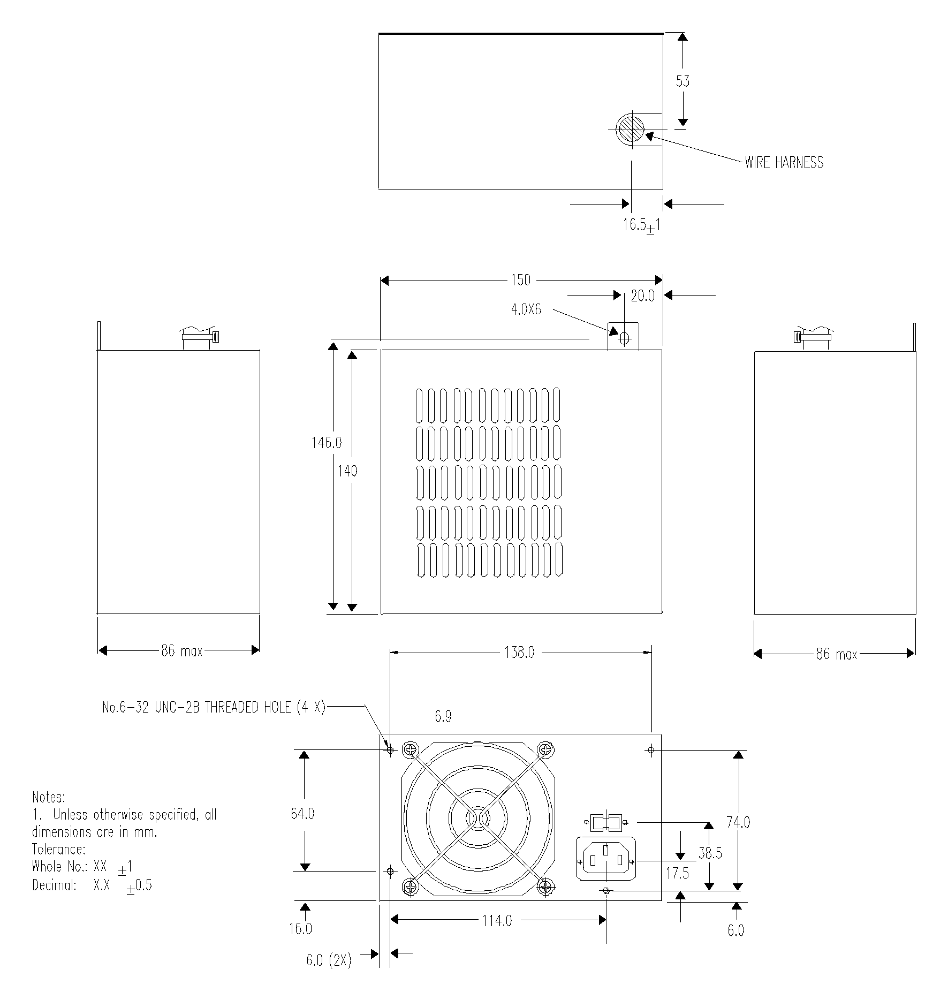
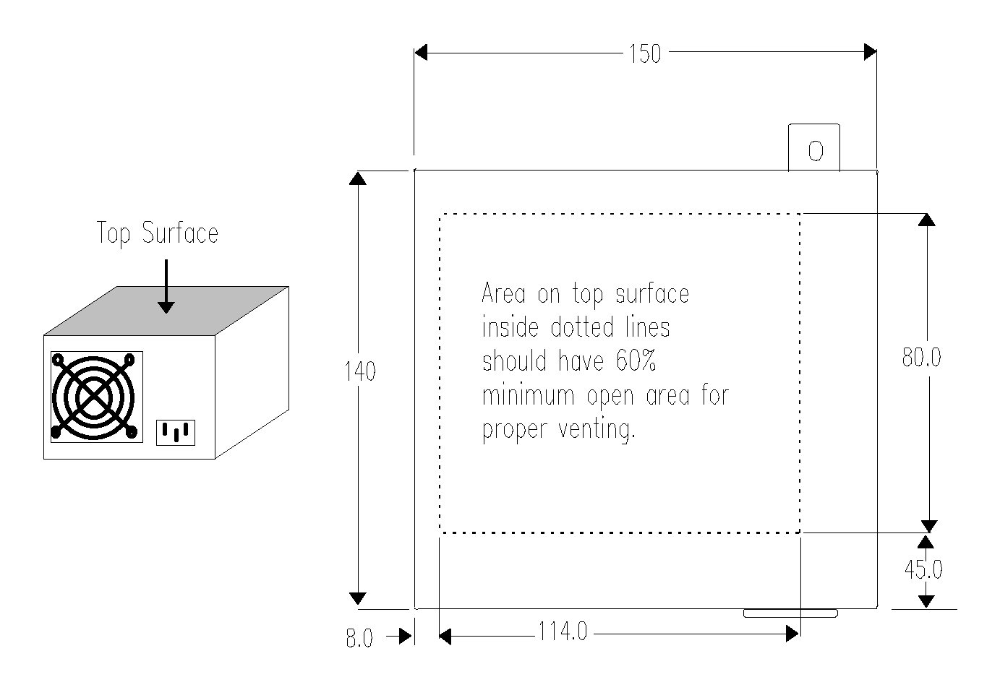
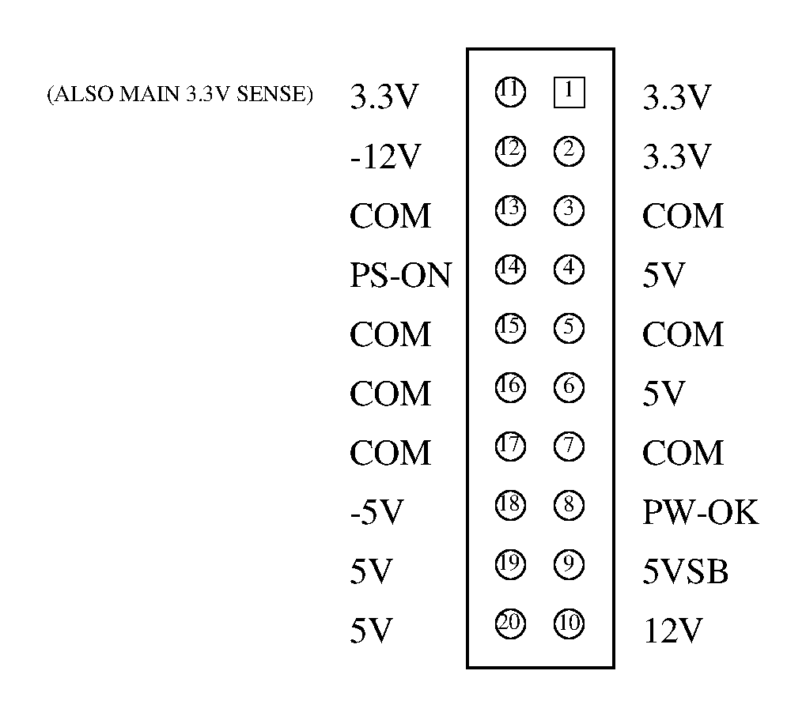
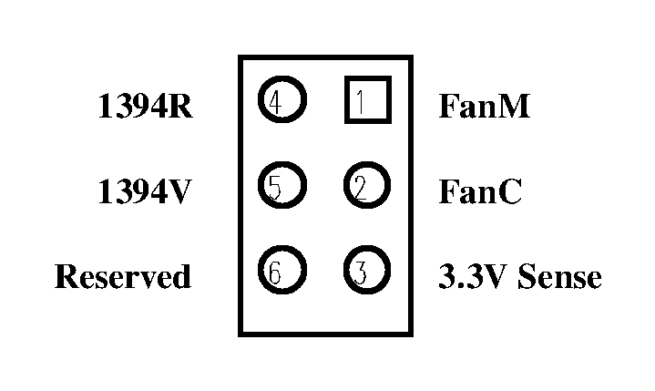
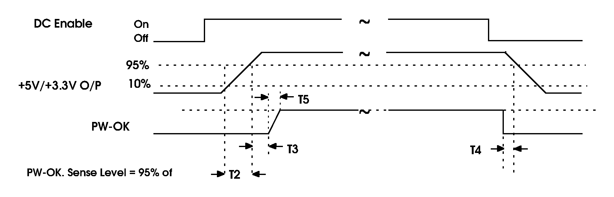
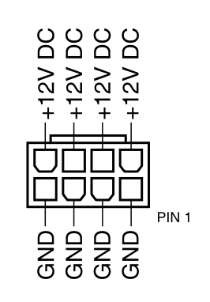
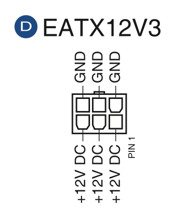

# ATX 电源

<figure markdown>
  { width="600" }
  <figcaption>ATX 电源机械尺寸（图源 <a href="http://bitsavers.informatik.uni-stuttgart.de/pdf/intel/ATX/ATX_Specification_2.01_199702.PDF">ATX Specification 2.01</a>）</figcaption>
</figure>

<figure markdown>
  { width="600" }
  <figcaption>电源通风开孔建议（图源 <a href="http://bitsavers.informatik.uni-stuttgart.de/pdf/intel/ATX/ATX_Specification_2.01_199702.PDF">ATX Specification 2.01</a>）</figcaption>
</figure>

## 24-pin Main Power Connector

- Pin 1: +3.3V DC Orange
- Pin 2: +3.3V DC Orange
- Pin 3: COM Black
- Pin 4: +5V DC Red
- Pin 5: COM Black
- Pin 6: +5V DC Red
- Pin 7: COM Black
- Pin 8: PWR_OK Gray
- Pin 9: +5VSB Purple
- Pin 10: +12V1 DC Yellow
- Pin 11: +12V1 DC Yellow
- Pin 12: +3.3V DC Orange
- Pin 13: +3.3V DC Orange
- Pin 14: -12V DC Blue
- Pin 15: COM Black
- Pin 16: PS_ON# Green
- Pin 17: COM Black
- Pin 18: COM Black
- Pin 19: COM Black
- Pin 20: Reserved NC
- Pin 21: +5V DC Red
- Pin 22: +5V DC Red
- Pin 23: +5V DC Red
- Pin 24: COM Black

<figure markdown>
  { width="400" }
  <figcaption>24-pin ATX_PWR（图源 <a href="https://rog.asus.com/motherboards/rog-strix/rog-strix-z790-a-gaming-wifi-model/helpdesk_manual/">ROG STRIX Z790-A GAMING WIFI User's Manual</a>）</figcaption>
</figure>

Source: <https://edc.intel.com/content/www/us/en/design/ipla/software-development-platforms/client/platforms/alder-lake-desktop/atx-version-3-0-multi-rail-desktop-platform-power-supply-design-guide/2.0/2.1a/main-power-connector-required/>, <https://en.wikipedia.org/wiki/ATX#Power_supply>, <https://www.moddiy.com/pages/Power-Supply-Connectors-and-Pinouts.html>, <https://sparks.gogo.co.nz/atx-pcie-power-supply-connector-guide.html>

更早的 ATX 用的是 20-pin 的版本，所以 ATX 电源为了兼容新旧主板，通常会提供 20+4 pin 的线。

<figure markdown>
  { width="480" }
  <figcaption>20-pin 主供电接口（图源 <a href="http://bitsavers.informatik.uni-stuttgart.de/pdf/intel/ATX/ATX_Specification_2.01_199702.PDF">ATX Specification 2.01</a>）</figcaption>
</figure>

<figure markdown>
  { width="340" }
  <figcaption>可选 2×3 辅助接口（图源 <a href="http://bitsavers.informatik.uni-stuttgart.de/pdf/intel/ATX/ATX_Specification_2.01_199702.PDF">ATX Specification 2.01</a>）</figcaption>
</figure>

<figure markdown>
  { width="600" }
  <figcaption>PS-ON / PW-OK 时序（图源 <a href="http://bitsavers.informatik.uni-stuttgart.de/pdf/intel/ATX/ATX_Specification_2.01_199702.PDF">ATX Specification 2.01</a>）</figcaption>
</figure>

## 8-pin CPU Power

<figure markdown>
  { width="400" }
  <figcaption>8-pin CPU Power（图源 <a href="https://rog.asus.com/motherboards/rog-strix/rog-strix-z790-a-gaming-wifi-model/helpdesk_manual/">ROG STRIX Z790-A GAMING WIFI User's Manual</a>）</figcaption>
</figure>

有一些 CPU 供电用的是 4-pin，所以 ATX 电源会提供 4+4 pin 的 CPU 电源线。

## 6-pin PCIe Power

<figure markdown>
  { width="400" }
  <figcaption>6-pin PCIe Power（图源 <a href="https://www.asus.com/motherboards-components/motherboards/workstation/ws-x299-pro-se/helpdesk_manual?model2Name=WS-X299-PRO-SE">WS X299 PRO User Manual</a>）</figcaption>
</figure>

有一些 PCIe 供电是 8-pin，所以 ATX 电源会提供 6+2 pin 的 PCIe 电源线。
