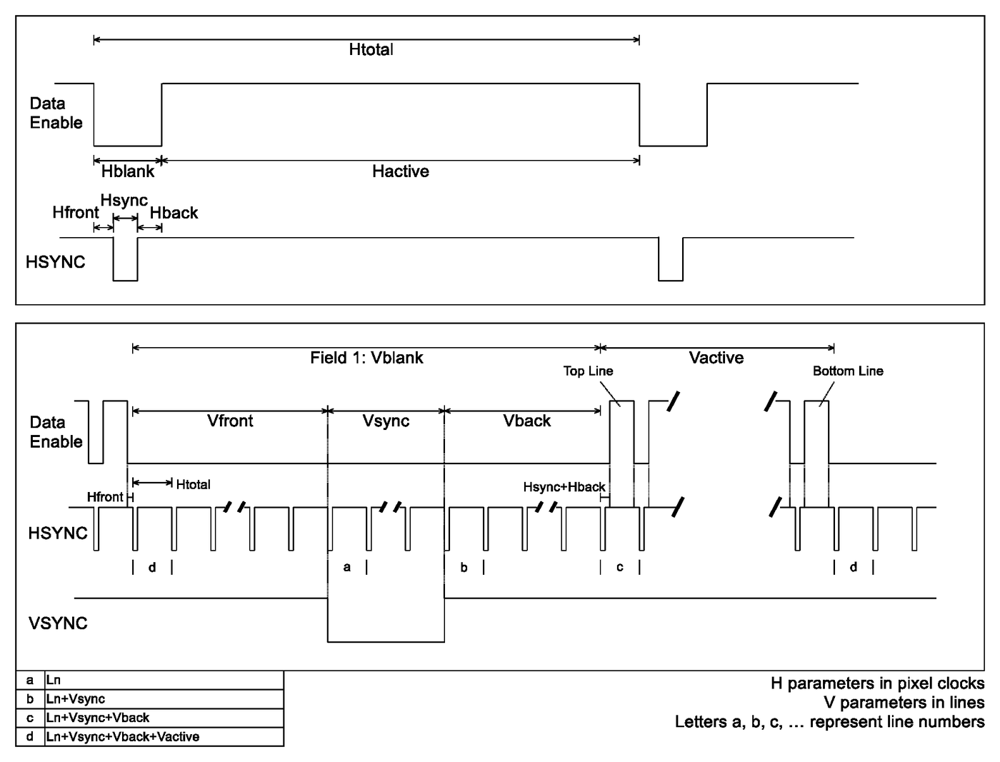

# CTA-861 VIC 表

<figure markdown>
  { width="720" }
  <figcaption>时序参数定义：H 参数以像素时钟为单位，V 参数以行为单位（图源 CTA-861）</figcaption>
</figure>

下面每一行是一种 Video Timing，各部分的含义：

- **VIC**：Video Identification Code，给「时序 + 宽高比」组合分配的编号
- **宽高比**：画面宽高比（Picture Aspect Ratio），同一时序的 4:3 和 16:9 是两个不同的 VIC
- **Hactive / Vactive**：有效像素列数 / 有效行数，对应 Data Enable 为高的部分
- **I/P**：Prog 为逐行，Int 为隔行
- **Htotal / Vtotal**：一行 / 一场的总像素数、总行数，包含消隐区
- **Hblank / Vblank**：行消隐像素数、场消隐行数，即 Htotal − Hactive、Vtotal − Vactive
- **Hfront / Hsync / Hback**：行消隐的三段（前肩、同步脉冲、后肩），三者之和等于 Hblank
- **Vfront / Vsync / Vback**：场消隐的三段；逐行时三者之和等于 Vblank，隔行时单场是整数行，Vblank 可能取平均值（如 1080i 的 22.5）
- **Hpol / Vpol**：行 / 场同步极性，P 为正极性，N 为负极性
- **Ln**：VSYNC 起始行号，即 field 1 中垂直同步前沿所在的行
- **H Freq**：行频，每秒扫描的行数
- **V Freq**：场频；逐行时就是帧率，隔行时是场率
- **Pixel Freq**：像素时钟频率

这些量之间是相互约束的：

- Pixel Freq = Htotal × H Freq
- 逐行时 H Freq = V Freq × Vtotal；隔行时 H Freq = V Freq × Vtotal / 2（每个场只有 Vtotal/2 行）
- 隔行的 Vblank 按场计，等于 (Vtotal − Vactive) / 2，所以 1080i 的 Vblank 是 22.5 行

另外 480i/240p/576i/288p 这类格式在接口上是双时钟的，Hactive 记的是双倍值（1440/2880），实际有效像素是 720/1440。

- **1**: 640×480p (4:3), 59.940 Hz, 25.175 MHz; Htotal 800, Hblank 160, Vtotal 525, Vblank 45, H Freq 31.469 kHz; Hfront 16, Hsync 96, Hback 48, Hpol N, Vfront 10, Vsync 2, Vback 33, Vpol N, Ln 1
- **2**: 720×480p (4:3), 59.940 Hz, 27.000 MHz; Htotal 858, Hblank 138, Vtotal 525, Vblank 45, H Freq 31.469 kHz; Hfront 16, Hsync 62, Hback 60, Hpol N, Vfront 9, Vsync 6, Vback 30, Vpol N, Ln 7
- **3**: 720×480p (16:9), 59.940 Hz, 27.000 MHz; Htotal 858, Hblank 138, Vtotal 525, Vblank 45, H Freq 31.469 kHz; Hfront 16, Hsync 62, Hback 60, Hpol N, Vfront 9, Vsync 6, Vback 30, Vpol N, Ln 7
- **4**: 1280×720p (16:9), 60.000 Hz, 74.250 MHz; Htotal 1650, Hblank 370, Vtotal 750, Vblank 30, H Freq 45.000 kHz; Hfront 110, Hsync 40, Hback 220, Hpol P, Vfront 5, Vsync 5, Vback 20, Vpol P, Ln 1
- **5**: 1920×1080i (16:9), 60.000 Hz, 74.250 MHz; Htotal 2200, Hblank 280, Vtotal 1125, Vblank 22.5, H Freq 33.750 kHz; Hfront 88, Hsync 44, Hback 148, Hpol P, Vfront 2, Vsync 5, Vback 15, Vpol P, Ln 1
- **6**: 1440×480i (4:3), 59.940 Hz, 27.000 MHz; Htotal 1716, Hblank 276, Vtotal 525, Vblank 22.5, H Freq 15.734 kHz; Hfront 38, Hsync 124, Hback 114, Hpol N, Vfront 4, Vsync 3, Vback 15, Vpol N, Ln 4
- **7**: 1440×480i (16:9), 59.940 Hz, 27.000 MHz; Htotal 1716, Hblank 276, Vtotal 525, Vblank 22.5, H Freq 15.734 kHz; Hfront 38, Hsync 124, Hback 114, Hpol N, Vfront 4, Vsync 3, Vback 15, Vpol N, Ln 4
- **8**: 1440×240p (4:3), 60.054 Hz, 27.000 MHz; Htotal 1716, Hblank 276, Vtotal 262, Vblank 22, H Freq 15.734 kHz; Hfront 38, Hsync 124, Hback 114, Hpol N, Vfront 4, Vsync 3, Vback 15, Vpol N, Ln 4
- **8**: 1440×240p (4:3), 59.826 Hz, 27.000 MHz; Htotal 1716, Hblank 276, Vtotal 263, Vblank 23, H Freq 15.734 kHz; Hfront 38, Hsync 124, Hback 114, Hpol N, Vfront 5, Vsync 3, Vback 15, Vpol N, Ln 4
- **9**: 1440×240p (16:9), 60.054 Hz, 27.000 MHz; Htotal 1716, Hblank 276, Vtotal 262, Vblank 22, H Freq 15.734 kHz; Hfront 38, Hsync 124, Hback 114, Hpol N, Vfront 4, Vsync 3, Vback 15, Vpol N, Ln 4
- **9**: 1440×240p (16:9), 59.826 Hz, 27.000 MHz; Htotal 1716, Hblank 276, Vtotal 263, Vblank 23, H Freq 15.734 kHz; Hfront 38, Hsync 124, Hback 114, Hpol N, Vfront 5, Vsync 3, Vback 15, Vpol N, Ln 4
- **10**: 2880×480i (4:3), 59.940 Hz, 54.000 MHz; Htotal 3432, Hblank 552, Vtotal 525, Vblank 22.5, H Freq 15.734 kHz; Hfront 76, Hsync 248, Hback 228, Hpol N, Vfront 4, Vsync 3, Vback 15, Vpol N, Ln 4
- **11**: 2880×480i (16:9), 59.940 Hz, 54.000 MHz; Htotal 3432, Hblank 552, Vtotal 525, Vblank 22.5, H Freq 15.734 kHz; Hfront 76, Hsync 248, Hback 228, Hpol N, Vfront 4, Vsync 3, Vback 15, Vpol N, Ln 4
- **12**: 2880×240p (4:3), 60.054 Hz, 54.000 MHz; Htotal 3432, Hblank 552, Vtotal 262, Vblank 22, H Freq 15.734 kHz; Hfront 76, Hsync 248, Hback 228, Hpol N, Vfront 4, Vsync 3, Vback 15, Vpol N, Ln 4
- **12**: 2880×240p (4:3), 59.826 Hz, 54.000 MHz; Htotal 3432, Hblank 552, Vtotal 263, Vblank 23, H Freq 15.734 kHz; Hfront 76, Hsync 248, Hback 228, Hpol N, Vfront 5, Vsync 3, Vback 15, Vpol N, Ln 4
- **13**: 2880×240p (16:9), 60.054 Hz, 54.000 MHz; Htotal 3432, Hblank 552, Vtotal 262, Vblank 22, H Freq 15.734 kHz; Hfront 76, Hsync 248, Hback 228, Hpol N, Vfront 4, Vsync 3, Vback 15, Vpol N, Ln 4
- **13**: 2880×240p (16:9), 59.826 Hz, 54.000 MHz; Htotal 3432, Hblank 552, Vtotal 263, Vblank 23, H Freq 15.734 kHz; Hfront 76, Hsync 248, Hback 228, Hpol N, Vfront 5, Vsync 3, Vback 15, Vpol N, Ln 4
- **14**: 1440×480p (4:3), 59.940 Hz, 54.000 MHz; Htotal 1716, Hblank 276, Vtotal 525, Vblank 45, H Freq 31.469 kHz; Hfront 32, Hsync 124, Hback 120, Hpol N, Vfront 9, Vsync 6, Vback 30, Vpol N, Ln 7
- **15**: 1440×480p (16:9), 59.940 Hz, 54.000 MHz; Htotal 1716, Hblank 276, Vtotal 525, Vblank 45, H Freq 31.469 kHz; Hfront 32, Hsync 124, Hback 120, Hpol N, Vfront 9, Vsync 6, Vback 30, Vpol N, Ln 7
- **16**: 1920×1080p (16:9), 60.000 Hz, 148.500 MHz; Htotal 2200, Hblank 280, Vtotal 1125, Vblank 45, H Freq 67.500 kHz; Hfront 88, Hsync 44, Hback 148, Hpol P, Vfront 4, Vsync 5, Vback 36, Vpol P, Ln 1
- **17**: 720×576p (4:3), 50.000 Hz, 27.000 MHz; Htotal 864, Hblank 144, Vtotal 625, Vblank 49, H Freq 31.250 kHz; Hfront 12, Hsync 64, Hback 68, Hpol N, Vfront 5, Vsync 5, Vback 39, Vpol N, Ln 1
- **18**: 720×576p (16:9), 50.000 Hz, 27.000 MHz; Htotal 864, Hblank 144, Vtotal 625, Vblank 49, H Freq 31.250 kHz; Hfront 12, Hsync 64, Hback 68, Hpol N, Vfront 5, Vsync 5, Vback 39, Vpol N, Ln 1
- **19**: 1280×720p (16:9), 50.000 Hz, 74.250 MHz; Htotal 1980, Hblank 700, Vtotal 750, Vblank 30, H Freq 37.500 kHz; Hfront 440, Hsync 40, Hback 220, Hpol P, Vfront 5, Vsync 5, Vback 20, Vpol P, Ln 1
- **20**: 1920×1080i (16:9), 50.000 Hz, 74.250 MHz; Htotal 2640, Hblank 720, Vtotal 1125, Vblank 22.5, H Freq 28.125 kHz; Hfront 528, Hsync 44, Hback 148, Hpol P, Vfront 2, Vsync 5, Vback 15, Vpol P, Ln 1
- **21**: 1440×576i (4:3), 50.000 Hz, 27.000 MHz; Htotal 1728, Hblank 288, Vtotal 625, Vblank 24.5, H Freq 15.625 kHz; Hfront 24, Hsync 126, Hback 138, Hpol N, Vfront 2, Vsync 3, Vback 19, Vpol N, Ln 1
- **22**: 1440×576i (16:9), 50.000 Hz, 27.000 MHz; Htotal 1728, Hblank 288, Vtotal 625, Vblank 24.5, H Freq 15.625 kHz; Hfront 24, Hsync 126, Hback 138, Hpol N, Vfront 2, Vsync 3, Vback 19, Vpol N, Ln 1
- **23**: 1440×288p (4:3), 50.080 Hz, 27.000 MHz; Htotal 1728, Hblank 288, Vtotal 312, Vblank 24, H Freq 15.625 kHz; Hfront 24, Hsync 126, Hback 138, Hpol N, Vfront 2, Vsync 3, Vback 19, Vpol N, Ln 1
- **23**: 1440×288p (4:3), 49.920 Hz, 27.000 MHz; Htotal 1728, Hblank 288, Vtotal 313, Vblank 25, H Freq 15.625 kHz; Hfront 24, Hsync 126, Hback 138, Hpol N, Vfront 3, Vsync 3, Vback 19, Vpol N, Ln 1
- **23**: 1440×288p (4:3), 49.761 Hz, 27.000 MHz; Htotal 1728, Hblank 288, Vtotal 314, Vblank 26, H Freq 15.625 kHz; Hfront 24, Hsync 126, Hback 138, Hpol N, Vfront 4, Vsync 3, Vback 19, Vpol N, Ln 1
- **24**: 1440×288p (16:9), 50.080 Hz, 27.000 MHz; Htotal 1728, Hblank 288, Vtotal 312, Vblank 24, H Freq 15.625 kHz; Hfront 24, Hsync 126, Hback 138, Hpol N, Vfront 2, Vsync 3, Vback 19, Vpol N, Ln 1
- **24**: 1440×288p (16:9), 49.920 Hz, 27.000 MHz; Htotal 1728, Hblank 288, Vtotal 313, Vblank 25, H Freq 15.625 kHz; Hfront 24, Hsync 126, Hback 138, Hpol N, Vfront 3, Vsync 3, Vback 19, Vpol N, Ln 1
- **24**: 1440×288p (16:9), 49.761 Hz, 27.000 MHz; Htotal 1728, Hblank 288, Vtotal 314, Vblank 26, H Freq 15.625 kHz; Hfront 24, Hsync 126, Hback 138, Hpol N, Vfront 4, Vsync 3, Vback 19, Vpol N, Ln 1
- **25**: 2880×576i (4:3), 50.000 Hz, 54.000 MHz; Htotal 3456, Hblank 576, Vtotal 625, Vblank 24.5, H Freq 15.625 kHz; Hfront 48, Hsync 252, Hback 276, Hpol N, Vfront 2, Vsync 3, Vback 19, Vpol N, Ln 1
- **26**: 2880×576i (16:9), 50.000 Hz, 54.000 MHz; Htotal 3456, Hblank 576, Vtotal 625, Vblank 24.5, H Freq 15.625 kHz; Hfront 48, Hsync 252, Hback 276, Hpol N, Vfront 2, Vsync 3, Vback 19, Vpol N, Ln 1
- **27**: 2880×288p (4:3), 50.080 Hz, 54.000 MHz; Htotal 3456, Hblank 576, Vtotal 312, Vblank 24, H Freq 15.625 kHz; Hfront 48, Hsync 252, Hback 276, Hpol N, Vfront 2, Vsync 3, Vback 19, Vpol N, Ln 1
- **27**: 2880×288p (4:3), 49.920 Hz, 54.000 MHz; Htotal 3456, Hblank 576, Vtotal 313, Vblank 25, H Freq 15.625 kHz; Hfront 48, Hsync 252, Hback 276, Hpol N, Vfront 3, Vsync 3, Vback 19, Vpol N, Ln 1
- **27**: 2880×288p (4:3), 49.761 Hz, 54.000 MHz; Htotal 3456, Hblank 576, Vtotal 314, Vblank 26, H Freq 15.625 kHz; Hfront 48, Hsync 252, Hback 276, Hpol N, Vfront 4, Vsync 3, Vback 19, Vpol N, Ln 1
- **28**: 2880×288p (16:9), 50.080 Hz, 54.000 MHz; Htotal 3456, Hblank 576, Vtotal 312, Vblank 24, H Freq 15.625 kHz; Hfront 48, Hsync 252, Hback 276, Hpol N, Vfront 2, Vsync 3, Vback 19, Vpol N, Ln 1
- **28**: 2880×288p (16:9), 49.920 Hz, 54.000 MHz; Htotal 3456, Hblank 576, Vtotal 313, Vblank 25, H Freq 15.625 kHz; Hfront 48, Hsync 252, Hback 276, Hpol N, Vfront 3, Vsync 3, Vback 19, Vpol N, Ln 1
- **28**: 2880×288p (16:9), 49.761 Hz, 54.000 MHz; Htotal 3456, Hblank 576, Vtotal 314, Vblank 26, H Freq 15.625 kHz; Hfront 48, Hsync 252, Hback 276, Hpol N, Vfront 4, Vsync 3, Vback 19, Vpol N, Ln 1
- **29**: 1440×576p (4:3), 50.000 Hz, 54.000 MHz; Htotal 1728, Hblank 288, Vtotal 625, Vblank 49, H Freq 31.250 kHz; Hfront 24, Hsync 128, Hback 136, Hpol N, Vfront 5, Vsync 5, Vback 39, Vpol N, Ln 1
- **30**: 1440×576p (16:9), 50.000 Hz, 54.000 MHz; Htotal 1728, Hblank 288, Vtotal 625, Vblank 49, H Freq 31.250 kHz; Hfront 24, Hsync 128, Hback 136, Hpol N, Vfront 5, Vsync 5, Vback 39, Vpol N, Ln 1
- **31**: 1920×1080p (16:9), 50.000 Hz, 148.500 MHz; Htotal 2640, Hblank 720, Vtotal 1125, Vblank 45, H Freq 56.250 kHz; Hfront 528, Hsync 44, Hback 148, Hpol P, Vfront 4, Vsync 5, Vback 36, Vpol P, Ln 1
- **32**: 1920×1080p (16:9), 24.000 Hz, 74.250 MHz; Htotal 2750, Hblank 830, Vtotal 1125, Vblank 45, H Freq 27.000 kHz; Hfront 638, Hsync 44, Hback 148, Hpol P, Vfront 4, Vsync 5, Vback 36, Vpol P, Ln 1
- **33**: 1920×1080p (16:9), 25.000 Hz, 74.250 MHz; Htotal 2640, Hblank 720, Vtotal 1125, Vblank 45, H Freq 28.125 kHz; Hfront 528, Hsync 44, Hback 148, Hpol P, Vfront 4, Vsync 5, Vback 36, Vpol P, Ln 1
- **34**: 1920×1080p (16:9), 30.000 Hz, 74.250 MHz; Htotal 2200, Hblank 280, Vtotal 1125, Vblank 45, H Freq 33.750 kHz; Hfront 88, Hsync 44, Hback 148, Hpol P, Vfront 4, Vsync 5, Vback 36, Vpol P, Ln 1
- **35**: 2880×480p (4:3), 59.940 Hz, 108.000 MHz; Htotal 3432, Hblank 552, Vtotal 525, Vblank 45, H Freq 31.469 kHz; Hfront 64, Hsync 248, Hback 240, Hpol N, Vfront 9, Vsync 6, Vback 30, Vpol N, Ln 7
- **36**: 2880×480p (16:9), 59.940 Hz, 108.000 MHz; Htotal 3432, Hblank 552, Vtotal 525, Vblank 45, H Freq 31.469 kHz; Hfront 64, Hsync 248, Hback 240, Hpol N, Vfront 9, Vsync 6, Vback 30, Vpol N, Ln 7
- **37**: 2880×576p (4:3), 50.000 Hz, 108.000 MHz; Htotal 3456, Hblank 576, Vtotal 625, Vblank 49, H Freq 31.250 kHz; Hfront 48, Hsync 256, Hback 272, Hpol N, Vfront 5, Vsync 5, Vback 39, Vpol N, Ln 1
- **38**: 2880×576p (16:9), 50.000 Hz, 108.000 MHz; Htotal 3456, Hblank 576, Vtotal 625, Vblank 49, H Freq 31.250 kHz; Hfront 48, Hsync 256, Hback 272, Hpol N, Vfront 5, Vsync 5, Vback 39, Vpol N, Ln 1
- **39**: 1920×1080i (16:9), 50.000 Hz, 72.000 MHz; Htotal 2304, Hblank 384, Vtotal 1250, Vblank 85, H Freq 31.250 kHz; Hfront 32, Hsync 168, Hback 184, Hpol P, Vfront 23, Vsync 5, Vback 57, Vpol N, Ln 1
- **40**: 1920×1080i (16:9), 100.00 Hz, 148.500 MHz; Htotal 2640, Hblank 720, Vtotal 1125, Vblank 22.5, H Freq 56.250 kHz; Hfront 528, Hsync 44, Hback 148, Hpol P, Vfront 2, Vsync 5, Vback 15, Vpol P, Ln 1
- **41**: 1280×720p (16:9), 100.00 Hz, 148.500 MHz; Htotal 1980, Hblank 700, Vtotal 750, Vblank 30, H Freq 75.000 kHz; Hfront 440, Hsync 40, Hback 220, Hpol P, Vfront 5, Vsync 5, Vback 20, Vpol P, Ln 1
- **42**: 720×576p (4:3), 100.00 Hz, 54.000 MHz; Htotal 864, Hblank 144, Vtotal 625, Vblank 49, H Freq 62.500 kHz; Hfront 12, Hsync 64, Hback 68, Hpol N, Vfront 5, Vsync 5, Vback 39, Vpol N, Ln 1
- **43**: 720×576p (16:9), 100.00 Hz, 54.000 MHz; Htotal 864, Hblank 144, Vtotal 625, Vblank 49, H Freq 62.500 kHz; Hfront 12, Hsync 64, Hback 68, Hpol N, Vfront 5, Vsync 5, Vback 39, Vpol N, Ln 1
- **44**: 1440×576i (4:3), 100.00 Hz, 54.000 MHz; Htotal 1728, Hblank 288, Vtotal 625, Vblank 24.5, H Freq 31.250 kHz; Hfront 24, Hsync 126, Hback 138, Hpol N, Vfront 2, Vsync 3, Vback 19, Vpol N, Ln 1
- **45**: 1440×576i (16:9), 100.00 Hz, 54.000 MHz; Htotal 1728, Hblank 288, Vtotal 625, Vblank 24.5, H Freq 31.250 kHz; Hfront 24, Hsync 126, Hback 138, Hpol N, Vfront 2, Vsync 3, Vback 19, Vpol N, Ln 1
- **46**: 1920×1080i (16:9), 120.00 Hz, 148.500 MHz; Htotal 2200, Hblank 280, Vtotal 1125, Vblank 22.5, H Freq 67.500 kHz; Hfront 88, Hsync 44, Hback 148, Hpol P, Vfront 2, Vsync 5, Vback 15, Vpol P, Ln 1
- **47**: 1280×720p (16:9), 120.00 Hz, 148.500 MHz; Htotal 1650, Hblank 370, Vtotal 750, Vblank 30, H Freq 90.000 kHz; Hfront 110, Hsync 40, Hback 220, Hpol P, Vfront 5, Vsync 5, Vback 20, Vpol P, Ln 1
- **48**: 720×480p (4:3), 119.88 Hz, 54.000 MHz; Htotal 858, Hblank 138, Vtotal 525, Vblank 45, H Freq 62.937 kHz; Hfront 16, Hsync 62, Hback 60, Hpol N, Vfront 9, Vsync 6, Vback 30, Vpol N, Ln 7
- **49**: 720×480p (16:9), 119.88 Hz, 54.000 MHz; Htotal 858, Hblank 138, Vtotal 525, Vblank 45, H Freq 62.937 kHz; Hfront 16, Hsync 62, Hback 60, Hpol N, Vfront 9, Vsync 6, Vback 30, Vpol N, Ln 7
- **50**: 1440×480i (4:3), 119.88 Hz, 54.000 MHz; Htotal 1716, Hblank 276, Vtotal 525, Vblank 22.5, H Freq 31.469 kHz; Hfront 38, Hsync 124, Hback 114, Hpol N, Vfront 4, Vsync 3, Vback 15, Vpol N, Ln 4
- **51**: 1440×480i (16:9), 119.88 Hz, 54.000 MHz; Htotal 1716, Hblank 276, Vtotal 525, Vblank 22.5, H Freq 31.469 kHz; Hfront 38, Hsync 124, Hback 114, Hpol N, Vfront 4, Vsync 3, Vback 15, Vpol N, Ln 4
- **52**: 720×576p (4:3), 200.00 Hz, 108.00 MHz; Htotal 864, Hblank 144, Vtotal 625, Vblank 49, H Freq 125.000 kHz; Hfront 12, Hsync 64, Hback 68, Hpol N, Vfront 5, Vsync 5, Vback 39, Vpol N, Ln 1
- **53**: 720×576p (16:9), 200.00 Hz, 108.00 MHz; Htotal 864, Hblank 144, Vtotal 625, Vblank 49, H Freq 125.000 kHz; Hfront 12, Hsync 64, Hback 68, Hpol N, Vfront 5, Vsync 5, Vback 39, Vpol N, Ln 1
- **54**: 1440×576i (4:3), 200.00 Hz, 108.00 MHz; Htotal 1728, Hblank 288, Vtotal 625, Vblank 24.5, H Freq 62.500 kHz; Hfront 24, Hsync 126, Hback 138, Hpol N, Vfront 2, Vsync 3, Vback 19, Vpol N, Ln 1
- **55**: 1440×576i (16:9), 200.00 Hz, 108.00 MHz; Htotal 1728, Hblank 288, Vtotal 625, Vblank 24.5, H Freq 62.500 kHz; Hfront 24, Hsync 126, Hback 138, Hpol N, Vfront 2, Vsync 3, Vback 19, Vpol N, Ln 1
- **56**: 720×480p (4:3), 239.76 Hz, 108.000 MHz; Htotal 858, Hblank 138, Vtotal 525, Vblank 45, H Freq 125.874 kHz; Hfront 16, Hsync 62, Hback 60, Hpol N, Vfront 9, Vsync 6, Vback 30, Vpol N, Ln 7
- **57**: 720×480p (16:9), 239.76 Hz, 108.000 MHz; Htotal 858, Hblank 138, Vtotal 525, Vblank 45, H Freq 125.874 kHz; Hfront 16, Hsync 62, Hback 60, Hpol N, Vfront 9, Vsync 6, Vback 30, Vpol N, Ln 7
- **58**: 1440×480i (4:3), 239.76 Hz, 108.000 MHz; Htotal 1716, Hblank 276, Vtotal 525, Vblank 22.5, H Freq 62.937 kHz; Hfront 38, Hsync 124, Hback 114, Hpol N, Vfront 4, Vsync 3, Vback 15, Vpol N, Ln 4
- **59**: 1440×480i (16:9), 239.76 Hz, 108.000 MHz; Htotal 1716, Hblank 276, Vtotal 525, Vblank 22.5, H Freq 62.937 kHz; Hfront 38, Hsync 124, Hback 114, Hpol N, Vfront 4, Vsync 3, Vback 15, Vpol N, Ln 4
- **60**: 1280×720p (16:9), 24.000 Hz, 59.400 MHz; Htotal 3300, Hblank 2020, Vtotal 750, Vblank 30, H Freq 18.000 kHz; Hfront 1760, Hsync 40, Hback 220, Hpol P, Vfront 5, Vsync 5, Vback 20, Vpol P, Ln 1
- **61**: 1280×720p (16:9), 25.000 Hz, 74.250 MHz; Htotal 3960, Hblank 2680, Vtotal 750, Vblank 30, H Freq 18.750 kHz; Hfront 2420, Hsync 40, Hback 220, Hpol P, Vfront 5, Vsync 5, Vback 20, Vpol P, Ln 1
- **62**: 1280×720p (16:9), 30.000 Hz, 74.250 MHz; Htotal 3300, Hblank 2020, Vtotal 750, Vblank 30, H Freq 22.500 kHz; Hfront 1760, Hsync 40, Hback 220, Hpol P, Vfront 5, Vsync 5, Vback 20, Vpol P, Ln 1
- **63**: 1920×1080p (16:9), 120.00 Hz, 297.000 MHz; Htotal 2200, Hblank 280, Vtotal 1125, Vblank 45, H Freq 135.000 kHz; Hfront 88, Hsync 44, Hback 148, Hpol P, Vfront 4, Vsync 5, Vback 36, Vpol P, Ln 1
- **64**: 1920×1080p (16:9), 100.00 Hz, 297.000 MHz; Htotal 2640, Hblank 720, Vtotal 1125, Vblank 45, H Freq 112.500 kHz; Hfront 528, Hsync 44, Hback 148, Hpol P, Vfront 4, Vsync 5, Vback 36, Vpol P, Ln 1
- **65**: 1280×720p (64:27), 24.000 Hz, 59.400 MHz; Htotal 3300, Hblank 2020, Vtotal 750, Vblank 30, H Freq 18.000 kHz; Hfront 1760, Hsync 40, Hback 220, Hpol P, Vfront 5, Vsync 5, Vback 20, Vpol P, Ln 1
- **66**: 1280×720p (64:27), 25.000 Hz, 74.250 MHz; Htotal 3960, Hblank 2680, Vtotal 750, Vblank 30, H Freq 18.750 kHz; Hfront 2420, Hsync 40, Hback 220, Hpol P, Vfront 5, Vsync 5, Vback 20, Vpol P, Ln 1
- **67**: 1280×720p (64:27), 30.000 Hz, 74.250 MHz; Htotal 3300, Hblank 2020, Vtotal 750, Vblank 30, H Freq 22.500 kHz; Hfront 1760, Hsync 40, Hback 220, Hpol P, Vfront 5, Vsync 5, Vback 20, Vpol P, Ln 1
- **68**: 1280×720p (64:27), 50.000 Hz, 74.250 MHz; Htotal 1980, Hblank 700, Vtotal 750, Vblank 30, H Freq 37.500 kHz; Hfront 440, Hsync 40, Hback 220, Hpol P, Vfront 5, Vsync 5, Vback 20, Vpol P, Ln 1
- **69**: 1280×720p (64:27), 60.000 Hz, 74.250 MHz; Htotal 1650, Hblank 370, Vtotal 750, Vblank 30, H Freq 45.000 kHz; Hfront 110, Hsync 40, Hback 220, Hpol P, Vfront 5, Vsync 5, Vback 20, Vpol P, Ln 1
- **70**: 1280×720p (64:27), 100.00 Hz, 148.500 MHz; Htotal 1980, Hblank 700, Vtotal 750, Vblank 30, H Freq 75.000 kHz; Hfront 440, Hsync 40, Hback 220, Hpol P, Vfront 5, Vsync 5, Vback 20, Vpol P, Ln 1
- **71**: 1280×720p (64:27), 120.00 Hz, 148.500 MHz; Htotal 1650, Hblank 370, Vtotal 750, Vblank 30, H Freq 90.000 kHz; Hfront 110, Hsync 40, Hback 220, Hpol P, Vfront 5, Vsync 5, Vback 20, Vpol P, Ln 1
- **72**: 1920×1080p (64:27), 24.000 Hz, 74.250 MHz; Htotal 2750, Hblank 830, Vtotal 1125, Vblank 45, H Freq 27.000 kHz; Hfront 638, Hsync 44, Hback 148, Hpol P, Vfront 4, Vsync 5, Vback 36, Vpol P, Ln 1
- **73**: 1920×1080p (64:27), 25.000 Hz, 74.250 MHz; Htotal 2640, Hblank 720, Vtotal 1125, Vblank 45, H Freq 28.125 kHz; Hfront 528, Hsync 44, Hback 148, Hpol P, Vfront 4, Vsync 5, Vback 36, Vpol P, Ln 1
- **74**: 1920×1080p (64:27), 30.000 Hz, 74.250 MHz; Htotal 2200, Hblank 280, Vtotal 1125, Vblank 45, H Freq 33.750 kHz; Hfront 88, Hsync 44, Hback 148, Hpol P, Vfront 4, Vsync 5, Vback 36, Vpol P, Ln 1
- **75**: 1920×1080p (64:27), 50.000 Hz, 148.500 MHz; Htotal 2640, Hblank 720, Vtotal 1125, Vblank 45, H Freq 56.250 kHz; Hfront 528, Hsync 44, Hback 148, Hpol P, Vfront 4, Vsync 5, Vback 36, Vpol P, Ln 1
- **76**: 1920×1080p (64:27), 60.000 Hz, 148.500 MHz; Htotal 2200, Hblank 280, Vtotal 1125, Vblank 45, H Freq 67.500 kHz; Hfront 88, Hsync 44, Hback 148, Hpol P, Vfront 4, Vsync 5, Vback 36, Vpol P, Ln 1
- **77**: 1920×1080p (64:27), 100.00 Hz, 297.000 MHz; Htotal 2640, Hblank 720, Vtotal 1125, Vblank 45, H Freq 112.500 kHz; Hfront 528, Hsync 44, Hback 148, Hpol P, Vfront 4, Vsync 5, Vback 36, Vpol P, Ln 1
- **78**: 1920×1080p (64:27), 120.00 Hz, 297.000 MHz; Htotal 2200, Hblank 280, Vtotal 1125, Vblank 45, H Freq 135.000 kHz; Hfront 88, Hsync 44, Hback 148, Hpol P, Vfront 4, Vsync 5, Vback 36, Vpol P, Ln 1
- **79**: 1680×720p (64:27), 24.000 Hz, 59.400 MHz; Htotal 3300, Hblank 1620, Vtotal 750, Vblank 30, H Freq 18.000 kHz; Hfront 1360, Hsync 40, Hback 220, Hpol P, Vfront 5, Vsync 5, Vback 20, Vpol P, Ln 1
- **80**: 1680×720p (64:27), 25.000 Hz, 59.400 MHz; Htotal 3168, Hblank 1488, Vtotal 750, Vblank 30, H Freq 18.750 kHz; Hfront 1228, Hsync 40, Hback 220, Hpol P, Vfront 5, Vsync 5, Vback 20, Vpol P, Ln 1
- **81**: 1680×720p (64:27), 30.000 Hz, 59.400 MHz; Htotal 2640, Hblank 960, Vtotal 750, Vblank 30, H Freq 22.500 kHz; Hfront 700, Hsync 40, Hback 220, Hpol P, Vfront 5, Vsync 5, Vback 20, Vpol P, Ln 1
- **82**: 1680×720p (64:27), 50.000 Hz, 82.500 MHz; Htotal 2200, Hblank 520, Vtotal 750, Vblank 30, H Freq 37.500 kHz; Hfront 260, Hsync 40, Hback 220, Hpol P, Vfront 5, Vsync 5, Vback 20, Vpol P, Ln 1
- **83**: 1680×720p (64:27), 60.000 Hz, 99.000 MHz; Htotal 2200, Hblank 520, Vtotal 750, Vblank 30, H Freq 45.000 kHz; Hfront 260, Hsync 40, Hback 220, Hpol P, Vfront 5, Vsync 5, Vback 20, Vpol P, Ln 1
- **84**: 1680×720p (64:27), 100.00 Hz, 165.000 MHz; Htotal 2000, Hblank 320, Vtotal 825, Vblank 105, H Freq 82.500 kHz; Hfront 60, Hsync 40, Hback 220, Hpol P, Vfront 5, Vsync 5, Vback 95, Vpol P, Ln 1
- **85**: 1680×720p (64:27), 120.00 Hz, 198.000 MHz; Htotal 2000, Hblank 320, Vtotal 825, Vblank 105, H Freq 99.000 kHz; Hfront 60, Hsync 40, Hback 220, Hpol P, Vfront 5, Vsync 5, Vback 95, Vpol P, Ln 1
- **86**: 2560×1080p (64:27), 24.000 Hz, 99.000 MHz; Htotal 3750, Hblank 1190, Vtotal 1100, Vblank 20, H Freq 26.400 kHz; Hfront 998, Hsync 44, Hback 148, Hpol P, Vfront 4, Vsync 5, Vback 11, Vpol P, Ln 1
- **87**: 2560×1080p (64:27), 25.000 Hz, 90.000 MHz; Htotal 3200, Hblank 640, Vtotal 1125, Vblank 45, H Freq 28.125 kHz; Hfront 448, Hsync 44, Hback 148, Hpol P, Vfront 4, Vsync 5, Vback 36, Vpol P, Ln 1
- **88**: 2560×1080p (64:27), 30.000 Hz, 118.800 MHz; Htotal 3520, Hblank 960, Vtotal 1125, Vblank 45, H Freq 33.750 kHz; Hfront 768, Hsync 44, Hback 148, Hpol P, Vfront 4, Vsync 5, Vback 36, Vpol P, Ln 1
- **89**: 2560×1080p (64:27), 50.000 Hz, 185.625 MHz; Htotal 3300, Hblank 740, Vtotal 1125, Vblank 45, H Freq 56.250 kHz; Hfront 548, Hsync 44, Hback 148, Hpol P, Vfront 4, Vsync 5, Vback 36, Vpol P, Ln 1
- **90**: 2560×1080p (64:27), 60.000 Hz, 198.000 MHz; Htotal 3000, Hblank 440, Vtotal 1100, Vblank 20, H Freq 66.000 kHz; Hfront 248, Hsync 44, Hback 148, Hpol P, Vfront 4, Vsync 5, Vback 11, Vpol P, Ln 1
- **91**: 2560×1080p (64:27), 100.00 Hz, 371.250 MHz; Htotal 2970, Hblank 410, Vtotal 1250, Vblank 170, H Freq 125.000 kHz; Hfront 218, Hsync 44, Hback 148, Hpol P, Vfront 4, Vsync 5, Vback 161, Vpol P, Ln 1
- **92**: 2560×1080p (64:27), 120.00 Hz, 495.000 MHz; Htotal 3300, Hblank 740, Vtotal 1250, Vblank 170, H Freq 150.000 kHz; Hfront 548, Hsync 44, Hback 148, Hpol P, Vfront 4, Vsync 5, Vback 161, Vpol P, Ln 1
- **93**: 3840×2160p (16:9), 24.000 Hz, 297.000 MHz; Htotal 5500, Hblank 1660, Vtotal 2250, Vblank 90, H Freq 54.000 kHz; Hfront 1276, Hsync 88, Hback 296, Hpol P, Vfront 8, Vsync 10, Vback 72, Vpol P, Ln 1
- **94**: 3840×2160p (16:9), 25.000 Hz, 297.000 MHz; Htotal 5280, Hblank 1440, Vtotal 2250, Vblank 90, H Freq 56.250 kHz; Hfront 1056, Hsync 88, Hback 296, Hpol P, Vfront 8, Vsync 10, Vback 72, Vpol P, Ln 1
- **95**: 3840×2160p (16:9), 30.000 Hz, 297.000 MHz; Htotal 4400, Hblank 560, Vtotal 2250, Vblank 90, H Freq 67.500 kHz; Hfront 176, Hsync 88, Hback 296, Hpol P, Vfront 8, Vsync 10, Vback 72, Vpol P, Ln 1
- **96**: 3840×2160p (16:9), 50.000 Hz, 594.000 MHz; Htotal 5280, Hblank 1440, Vtotal 2250, Vblank 90, H Freq 112.500 kHz; Hfront 1056, Hsync 88, Hback 296, Hpol P, Vfront 8, Vsync 10, Vback 72, Vpol P, Ln 1
- **97**: 3840×2160p (16:9), 60.000 Hz, 594.000 MHz; Htotal 4400, Hblank 560, Vtotal 2250, Vblank 90, H Freq 135.000 kHz; Hfront 176, Hsync 88, Hback 296, Hpol P, Vfront 8, Vsync 10, Vback 72, Vpol P, Ln 1
- **98**: 4096×2160p (256:135), 24.000 Hz, 297.000 MHz; Htotal 5500, Hblank 1404, Vtotal 2250, Vblank 90, H Freq 54.000 kHz; Hfront 1020, Hsync 88, Hback 296, Hpol P, Vfront 8, Vsync 10, Vback 72, Vpol P, Ln 1
- **99**: 4096×2160p (256:135), 25.000 Hz, 297.000 MHz; Htotal 5280, Hblank 1184, Vtotal 2250, Vblank 90, H Freq 56.250 kHz; Hfront 968, Hsync 88, Hback 128, Hpol P, Vfront 8, Vsync 10, Vback 72, Vpol P, Ln 1
- **100**: 4096×2160p (256:135), 30.000 Hz, 297.000 MHz; Htotal 4400, Hblank 304, Vtotal 2250, Vblank 90, H Freq 67.500 kHz; Hfront 88, Hsync 88, Hback 128, Hpol P, Vfront 8, Vsync 10, Vback 72, Vpol P, Ln 1
- **101**: 4096×2160p (256:135), 50.000 Hz, 594.000 MHz; Htotal 5280, Hblank 1184, Vtotal 2250, Vblank 90, H Freq 112.500 kHz; Hfront 968, Hsync 88, Hback 128, Hpol P, Vfront 8, Vsync 10, Vback 72, Vpol P, Ln 1
- **102**: 4096×2160p (256:135), 60.000 Hz, 594.000 MHz; Htotal 4400, Hblank 304, Vtotal 2250, Vblank 90, H Freq 135.000 kHz; Hfront 88, Hsync 88, Hback 128, Hpol P, Vfront 8, Vsync 10, Vback 72, Vpol P, Ln 1
- **103**: 3840×2160p (64:27), 24.000 Hz, 297.000 MHz; Htotal 5500, Hblank 1660, Vtotal 2250, Vblank 90, H Freq 54.000 kHz; Hfront 1276, Hsync 88, Hback 296, Hpol P, Vfront 8, Vsync 10, Vback 72, Vpol P, Ln 1
- **104**: 3840×2160p (64:27), 25.000 Hz, 297.000 MHz; Htotal 5280, Hblank 1440, Vtotal 2250, Vblank 90, H Freq 56.250 kHz; Hfront 1056, Hsync 88, Hback 296, Hpol P, Vfront 8, Vsync 10, Vback 72, Vpol P, Ln 1
- **105**: 3840×2160p (64:27), 30.000 Hz, 297.000 MHz; Htotal 4400, Hblank 560, Vtotal 2250, Vblank 90, H Freq 67.500 kHz; Hfront 176, Hsync 88, Hback 296, Hpol P, Vfront 8, Vsync 10, Vback 72, Vpol P, Ln 1
- **106**: 3840×2160p (64:27), 50.000 Hz, 594.000 MHz; Htotal 5280, Hblank 1440, Vtotal 2250, Vblank 90, H Freq 112.500 kHz; Hfront 1056, Hsync 88, Hback 296, Hpol P, Vfront 8, Vsync 10, Vback 72, Vpol P, Ln 1
- **107**: 3840×2160p (64:27), 60.000 Hz, 594.000 MHz; Htotal 4400, Hblank 560, Vtotal 2250, Vblank 90, H Freq 135.000 kHz; Hfront 176, Hsync 88, Hback 296, Hpol P, Vfront 8, Vsync 10, Vback 72, Vpol P, Ln 1
- **108**: 1280×720p (16:9), 48.000 Hz, 90.000 MHz; Htotal 2500, Hblank 1220, Vtotal 750, Vblank 30, H Freq 36.000 kHz; Hfront 960, Hsync 40, Hback 220, Hpol P, Vfront 5, Vsync 5, Vback 20, Vpol P, Ln 1
- **109**: 1280×720p (64:27), 48.000 Hz, 90.000 MHz; Htotal 2500, Hblank 1220, Vtotal 750, Vblank 30, H Freq 36.000 kHz; Hfront 960, Hsync 40, Hback 220, Hpol P, Vfront 5, Vsync 5, Vback 20, Vpol P, Ln 1
- **110**: 1680×720p (64:27), 48.000 Hz, 99.000 MHz; Htotal 2750, Hblank 1070, Vtotal 750, Vblank 30, H Freq 36.000 kHz; Hfront 810, Hsync 40, Hback 220, Hpol P, Vfront 5, Vsync 5, Vback 20, Vpol P, Ln 1
- **111**: 1920×1080p (16:9), 48.000 Hz, 148.500 MHz; Htotal 2750, Hblank 830, Vtotal 1125, Vblank 45, H Freq 54.000 kHz; Hfront 638, Hsync 44, Hback 148, Hpol P, Vfront 4, Vsync 5, Vback 36, Vpol P, Ln 1
- **112**: 1920×1080p (64:27), 48.000 Hz, 148.500 MHz; Htotal 2750, Hblank 830, Vtotal 1125, Vblank 45, H Freq 54.000 kHz; Hfront 638, Hsync 44, Hback 148, Hpol P, Vfront 4, Vsync 5, Vback 36, Vpol P, Ln 1
- **113**: 2560×1080p (64:27), 48.000 Hz, 198.000 MHz; Htotal 3750, Hblank 1190, Vtotal 1100, Vblank 20, H Freq 52.800 kHz; Hfront 998, Hsync 44, Hback 148, Hpol P, Vfront 4, Vsync 5, Vback 11, Vpol P, Ln 1
- **114**: 3840×2160p (16:9), 48.000 Hz, 594.000 MHz; Htotal 5500, Hblank 1660, Vtotal 2250, Vblank 90, H Freq 108.000 kHz; Hfront 1276, Hsync 88, Hback 296, Hpol P, Vfront 8, Vsync 10, Vback 72, Vpol P, Ln 1
- **115**: 4096×2160p (256:135), 48.000 Hz, 594.000 MHz; Htotal 5500, Hblank 1404, Vtotal 2250, Vblank 90, H Freq 108.000 kHz; Hfront 1020, Hsync 88, Hback 296, Hpol P, Vfront 8, Vsync 10, Vback 72, Vpol P, Ln 1
- **116**: 3840×2160p (64:27), 48.000 Hz, 594.000 MHz; Htotal 5500, Hblank 1660, Vtotal 2250, Vblank 90, H Freq 108.000 kHz; Hfront 1276, Hsync 88, Hback 296, Hpol P, Vfront 8, Vsync 10, Vback 72, Vpol P, Ln 1
- **117**: 3840×2160p (16:9), 100.00 Hz, 1188.000 MHz; Htotal 5280, Hblank 1440, Vtotal 2250, Vblank 90, H Freq 225.000 kHz; Hfront 1056, Hsync 88, Hback 296, Hpol P, Vfront 8, Vsync 10, Vback 72, Vpol P, Ln 1
- **118**: 3840×2160p (16:9), 120.00 Hz, 1188.000 MHz; Htotal 4400, Hblank 560, Vtotal 2250, Vblank 90, H Freq 270.000 kHz; Hfront 176, Hsync 88, Hback 296, Hpol P, Vfront 8, Vsync 10, Vback 72, Vpol P, Ln 1
- **119**: 3840×2160p (64:27), 100.00 Hz, 1188.000 MHz; Htotal 5280, Hblank 1440, Vtotal 2250, Vblank 90, H Freq 225.000 kHz; Hfront 1056, Hsync 88, Hback 296, Hpol P, Vfront 8, Vsync 10, Vback 72, Vpol P, Ln 1
- **120**: 3840×2160p (64:27), 120.00 Hz, 1188.000 MHz; Htotal 4400, Hblank 560, Vtotal 2250, Vblank 90, H Freq 270.000 kHz; Hfront 176, Hsync 88, Hback 296, Hpol P, Vfront 8, Vsync 10, Vback 72, Vpol P, Ln 1
- **121**: 5120×2160p (64:27), 24.000 Hz, 396.000 MHz; Htotal 7500, Hblank 2380, Vtotal 2200, Vblank 40, H Freq 52.800 kHz; Hfront 1996, Hsync 88, Hback 296, Hpol P, Vfront 8, Vsync 10, Vback 22, Vpol P, Ln 1
- **122**: 5120×2160p (64:27), 25.000 Hz, 396.000 MHz; Htotal 7200, Hblank 2080, Vtotal 2200, Vblank 40, H Freq 55.000 kHz; Hfront 1696, Hsync 88, Hback 296, Hpol P, Vfront 8, Vsync 10, Vback 22, Vpol P, Ln 1
- **123**: 5120×2160p (64:27), 30.000 Hz, 396.000 MHz; Htotal 6000, Hblank 880, Vtotal 2200, Vblank 40, H Freq 66.000 kHz; Hfront 664, Hsync 88, Hback 128, Hpol P, Vfront 8, Vsync 10, Vback 22, Vpol P, Ln 1
- **124**: 5120×2160p (64:27), 48.000 Hz, 742.500 MHz; Htotal 6250, Hblank 1130, Vtotal 2475, Vblank 315, H Freq 118.800 kHz; Hfront 746, Hsync 88, Hback 296, Hpol P, Vfront 8, Vsync 10, Vback 297, Vpol P, Ln 1
- **125**: 5120×2160p (64:27), 50.000 Hz, 742.500 MHz; Htotal 6600, Hblank 1480, Vtotal 2250, Vblank 90, H Freq 112.500 kHz; Hfront 1096, Hsync 88, Hback 296, Hpol P, Vfront 8, Vsync 10, Vback 72, Vpol P, Ln 1
- **126**: 5120×2160p (64:27), 60.000 Hz, 742.500 MHz; Htotal 5500, Hblank 380, Vtotal 2250, Vblank 90, H Freq 135.000 kHz; Hfront 164, Hsync 88, Hback 128, Hpol P, Vfront 8, Vsync 10, Vback 72, Vpol P, Ln 1
- **127**: 5120×2160p (64:27), 100.00 Hz, 1485.000 MHz; Htotal 6600, Hblank 1480, Vtotal 2250, Vblank 90, H Freq 225.000 kHz; Hfront 1096, Hsync 88, Hback 296, Hpol P, Vfront 8, Vsync 10, Vback 72, Vpol P, Ln 1
- **193**: 5120×2160p (64:27), 120.00 Hz, 1485.000 MHz; Htotal 5500, Hblank 380, Vtotal 2250, Vblank 90, H Freq 270.000 kHz; Hfront 164, Hsync 88, Hback 128, Hpol P, Vfront 8, Vsync 10, Vback 72, Vpol P, Ln 1
- **194**: 7680×4320p (16:9), 24.000 Hz, 1188.000 MHz; Htotal 11000, Hblank 3320, Vtotal 4500, Vblank 180, H Freq 108.000 kHz; Hfront 2552, Hsync 176, Hback 592, Hpol P, Vfront 16, Vsync 20, Vback 144, Vpol P, Ln 1
- **195**: 7680×4320p (16:9), 25.000 Hz, 1188.000 MHz; Htotal 10800, Hblank 3120, Vtotal 4400, Vblank 80, H Freq 110.000 kHz; Hfront 2352, Hsync 176, Hback 592, Hpol P, Vfront 16, Vsync 20, Vback 44, Vpol P, Ln 1
- **196**: 7680×4320p (16:9), 30.000 Hz, 1188.000 MHz; Htotal 9000, Hblank 1320, Vtotal 4400, Vblank 80, H Freq 132.000 kHz; Hfront 552, Hsync 176, Hback 592, Hpol P, Vfront 16, Vsync 20, Vback 44, Vpol P, Ln 1
- **197**: 7680×4320p (16:9), 48.000 Hz, 2376.000 MHz; Htotal 11000, Hblank 3320, Vtotal 4500, Vblank 180, H Freq 216.000 kHz; Hfront 2552, Hsync 176, Hback 592, Hpol P, Vfront 16, Vsync 20, Vback 144, Vpol P, Ln 1
- **198**: 7680×4320p (16:9), 50.000 Hz, 2376.000 MHz; Htotal 10800, Hblank 3120, Vtotal 4400, Vblank 80, H Freq 220.000 kHz; Hfront 2352, Hsync 176, Hback 592, Hpol P, Vfront 16, Vsync 20, Vback 44, Vpol P, Ln 1
- **199**: 7680×4320p (16:9), 60.000 Hz, 2376.000 MHz; Htotal 9000, Hblank 1320, Vtotal 4400, Vblank 80, H Freq 264.000 kHz; Hfront 552, Hsync 176, Hback 592, Hpol P, Vfront 16, Vsync 20, Vback 44, Vpol P, Ln 1
- **200**: 7680×4320p (16:9), 100.00 Hz, 4752.000 MHz; Htotal 10560, Hblank 2880, Vtotal 4500, Vblank 180, H Freq 450.000 kHz; Hfront 2112, Hsync 176, Hback 592, Hpol P, Vfront 16, Vsync 20, Vback 144, Vpol P, Ln 1
- **201**: 7680×4320p (16:9), 120.00 Hz, 4752.000 MHz; Htotal 8800, Hblank 1120, Vtotal 4500, Vblank 180, H Freq 540.000 kHz; Hfront 352, Hsync 176, Hback 592, Hpol P, Vfront 16, Vsync 20, Vback 144, Vpol P, Ln 1
- **202**: 7680×4320p (64:27), 24.000 Hz, 1188.000 MHz; Htotal 11000, Hblank 3320, Vtotal 4500, Vblank 180, H Freq 108.000 kHz; Hfront 2552, Hsync 176, Hback 592, Hpol P, Vfront 16, Vsync 20, Vback 144, Vpol P, Ln 1
- **203**: 7680×4320p (64:27), 25.000 Hz, 1188.000 MHz; Htotal 10800, Hblank 3120, Vtotal 4400, Vblank 80, H Freq 110.000 kHz; Hfront 2352, Hsync 176, Hback 592, Hpol P, Vfront 16, Vsync 20, Vback 44, Vpol P, Ln 1
- **204**: 7680×4320p (64:27), 30.000 Hz, 1188.000 MHz; Htotal 9000, Hblank 1320, Vtotal 4400, Vblank 80, H Freq 132.000 kHz; Hfront 552, Hsync 176, Hback 592, Hpol P, Vfront 16, Vsync 20, Vback 44, Vpol P, Ln 1
- **205**: 7680×4320p (64:27), 48.000 Hz, 2376.000 MHz; Htotal 11000, Hblank 3320, Vtotal 4500, Vblank 180, H Freq 216.000 kHz; Hfront 2552, Hsync 176, Hback 592, Hpol P, Vfront 16, Vsync 20, Vback 144, Vpol P, Ln 1
- **206**: 7680×4320p (64:27), 50.000 Hz, 2376.000 MHz; Htotal 10800, Hblank 3120, Vtotal 4400, Vblank 80, H Freq 220.000 kHz; Hfront 2352, Hsync 176, Hback 592, Hpol P, Vfront 16, Vsync 20, Vback 44, Vpol P, Ln 1
- **207**: 7680×4320p (64:27), 60.000 Hz, 2376.000 MHz; Htotal 9000, Hblank 1320, Vtotal 4400, Vblank 80, H Freq 264.000 kHz; Hfront 552, Hsync 176, Hback 592, Hpol P, Vfront 16, Vsync 20, Vback 44, Vpol P, Ln 1
- **208**: 7680×4320p (64:27), 100.00 Hz, 4752.000 MHz; Htotal 10560, Hblank 2880, Vtotal 4500, Vblank 180, H Freq 450.000 kHz; Hfront 2112, Hsync 176, Hback 592, Hpol P, Vfront 16, Vsync 20, Vback 144, Vpol P, Ln 1
- **209**: 7680×4320p (64:27), 120.00 Hz, 4752.000 MHz; Htotal 8800, Hblank 1120, Vtotal 4500, Vblank 180, H Freq 540.000 kHz; Hfront 352, Hsync 176, Hback 592, Hpol P, Vfront 16, Vsync 20, Vback 144, Vpol P, Ln 1
- **210**: 10240×4320p (64:27), 24.000 Hz, 1485.000 MHz; Htotal 12500, Hblank 2260, Vtotal 4950, Vblank 630, H Freq 118.800 kHz; Hfront 1492, Hsync 176, Hback 592, Hpol P, Vfront 16, Vsync 20, Vback 594, Vpol P, Ln 1
- **211**: 10240×4320p (64:27), 25.000 Hz, 1485.000 MHz; Htotal 13500, Hblank 3260, Vtotal 4400, Vblank 80, H Freq 110.000 kHz; Hfront 2492, Hsync 176, Hback 592, Hpol P, Vfront 16, Vsync 20, Vback 44, Vpol P, Ln 1
- **212**: 10240×4320p (64:27), 30.000 Hz, 1485.000 MHz; Htotal 11000, Hblank 760, Vtotal 4500, Vblank 180, H Freq 135.000 kHz; Hfront 288, Hsync 176, Hback 296, Hpol P, Vfront 16, Vsync 20, Vback 144, Vpol P, Ln 1
- **213**: 10240×4320p (64:27), 48.000 Hz, 2970.000 MHz; Htotal 12500, Hblank 2260, Vtotal 4950, Vblank 630, H Freq 237.600 kHz; Hfront 1492, Hsync 176, Hback 592, Hpol P, Vfront 16, Vsync 20, Vback 594, Vpol P, Ln 1
- **214**: 10240×4320p (64:27), 50.000 Hz, 2970.000 MHz; Htotal 13500, Hblank 3260, Vtotal 4400, Vblank 80, H Freq 220.000 kHz; Hfront 2492, Hsync 176, Hback 592, Hpol P, Vfront 16, Vsync 20, Vback 44, Vpol P, Ln 1
- **215**: 10240×4320p (64:27), 60.000 Hz, 2970.000 MHz; Htotal 11000, Hblank 760, Vtotal 4500, Vblank 180, H Freq 270.000 kHz; Hfront 288, Hsync 176, Hback 296, Hpol P, Vfront 16, Vsync 20, Vback 144, Vpol P, Ln 1
- **216**: 10240×4320p (64:27), 100.00 Hz, 5940.000 MHz; Htotal 13200, Hblank 2960, Vtotal 4500, Vblank 180, H Freq 450.000 kHz; Hfront 2192, Hsync 176, Hback 592, Hpol P, Vfront 16, Vsync 20, Vback 144, Vpol P, Ln 1
- **217**: 10240×4320p (64:27), 120.00 Hz, 5940.000 MHz; Htotal 11000, Hblank 760, Vtotal 4500, Vblank 180, H Freq 540.000 kHz; Hfront 288, Hsync 176, Hback 296, Hpol P, Vfront 16, Vsync 20, Vback 144, Vpol P, Ln 1
- **218**: 4096×2160p (256:135), 100.00 Hz, 1188.000 MHz; Htotal 5280, Hblank 1184, Vtotal 2250, Vblank 90, H Freq 225.000 kHz; Hfront 800, Hsync 88, Hback 296, Hpol P, Vfront 8, Vsync 10, Vback 72, Vpol P, Ln 1
- **219**: 4096×2160p (256:135), 120.00 Hz, 1188.000 MHz; Htotal 4400, Hblank 304, Vtotal 2250, Vblank 90, H Freq 270.000 kHz; Hfront 88, Hsync 88, Hback 128, Hpol P, Vfront 8, Vsync 10, Vback 72, Vpol P, Ln 1
