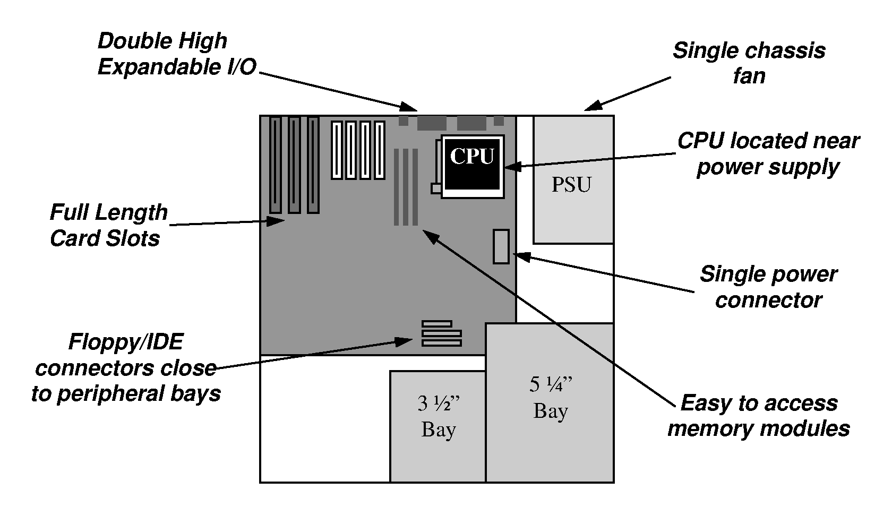
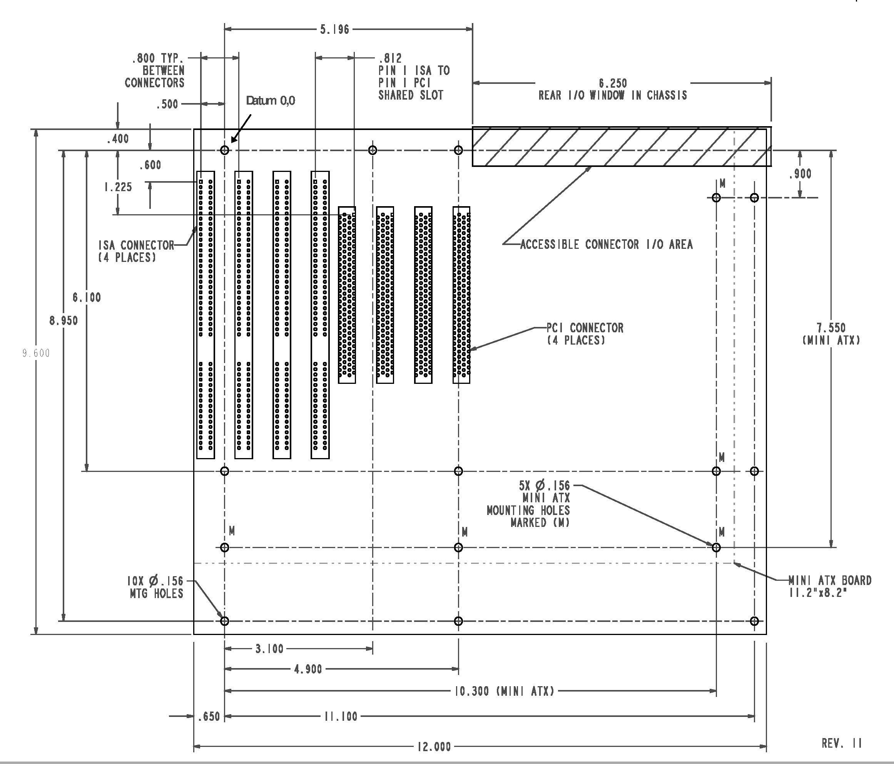
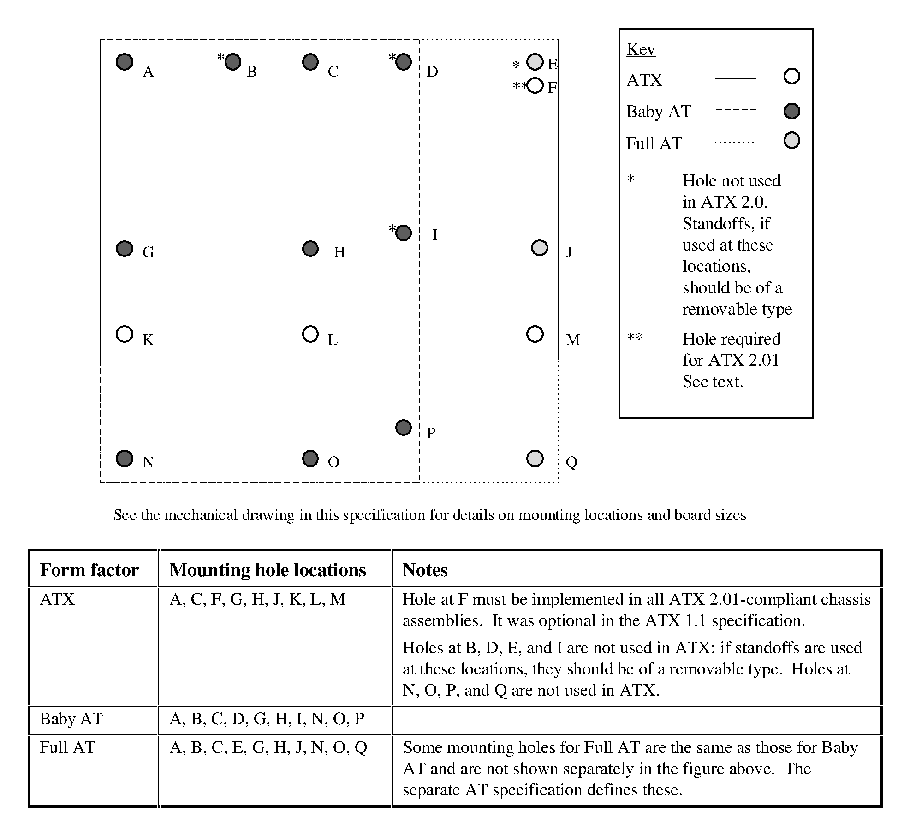
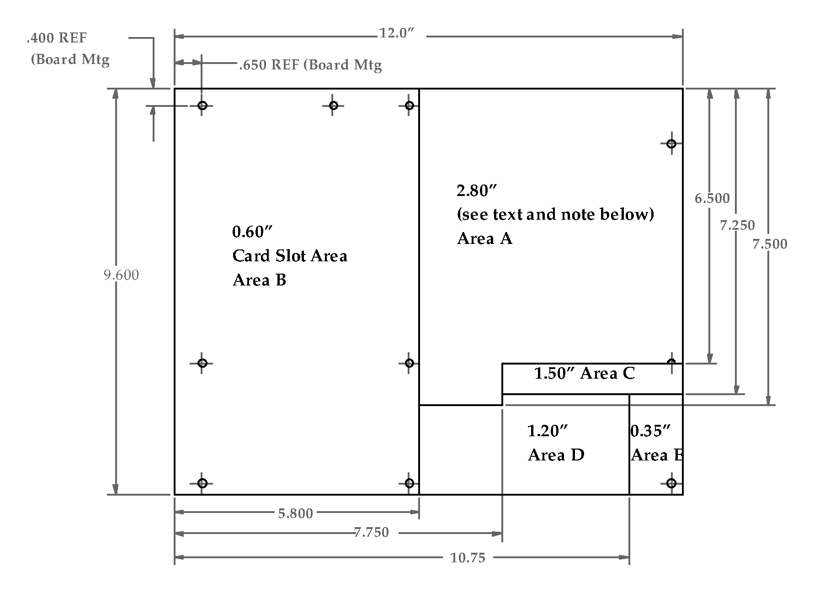
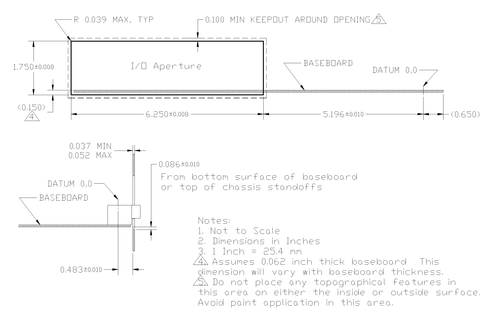

# 主板

<figure markdown>
  { width="600" }
  <figcaption>ATX 机箱布局（图源 <a href="http://bitsavers.informatik.uni-stuttgart.de/pdf/intel/ATX/ATX_Specification_2.01_199702.PDF">ATX Specification 2.01</a>）</figcaption>
</figure>

## 尺寸

参考 <https://en.wikipedia.org/wiki/DTX_(form_factor)> <https://www.silverstonetek.com/en/tech-talk/wh11_008> <https://en.wikipedia.org/wiki/ATX> <https://www.corsair.com/us/en/explorer/diy-builder/power-supply-units/ssi-eeb-and-ceb-motherboards-explained/>：

- Ultra ATX: 366mm x 244mm
- SSI MEB: 441mm x 330mm
- EATX(Extended ATX): 305mm x 330mm, 305mm x 257mm, 305mm x 264mm, 305mm x 267mm, 305mm x 272mm
- ATX: 305mm x 244mm
- mATX(microATX): 244mm x 244mm
- DTX: 203mm x 244mm
- miniDTX: 203mm x 170mm
- miniITX: 170mm x 170mm
- SSI-EEB: 305mm × 330mm
- SSI-CEB: 305mm × 266.7mm

<figure markdown>
  { width="700" }
  <figcaption>ATX/Mini-ATX 布局（图源 <a href="http://bitsavers.informatik.uni-stuttgart.de/pdf/intel/ATX/ATX_Specification_2.01_199702.PDF">ATX Specification 2.01</a>）</figcaption>
</figure>

<figure markdown>
  { width="700" }
  <figcaption>ATX / Baby AT / Full AT 安装孔位（图源 <a href="http://bitsavers.informatik.uni-stuttgart.de/pdf/intel/ATX/ATX_Specification_2.01_199702.PDF">ATX Specification 2.01</a>）</figcaption>
</figure>

<figure markdown>
  { width="650" }
  <figcaption>组件高度限制（图源 <a href="http://bitsavers.informatik.uni-stuttgart.de/pdf/intel/ATX/ATX_Specification_2.01_199702.PDF">ATX Specification 2.01</a>）</figcaption>
</figure>

<figure markdown>
  { width="700" }
  <figcaption>后置 I/O 开口（图源 <a href="http://bitsavers.informatik.uni-stuttgart.de/pdf/intel/ATX/ATX_Specification_2.01_199702.PDF">ATX Specification 2.01</a>）</figcaption>
</figure>

## 供电

ATX 常见供电接口是 24pin（20+4pin），提供了 +3.3V，+5V，+12V 和 -12V。除了电和地以外，还有信号线：

- PS_ON#：power supply on，主板通过拉低 PS_ON# 让电源启动；有一个特殊的 +5V standby 电源不受 PS_ON# 影响
- PWR_OK：power good，电源通知主板，输出的电源已经可用

见 [ATX 电源](./atx_power.md)。
