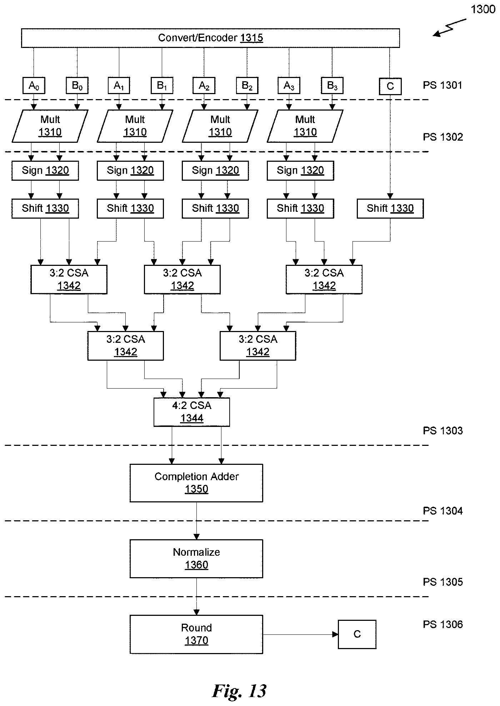

# NVIDIA Tensor Core

## Volta

Volta 的每个 Tensor Core 每周期（吞吐）能做一个 $4\times4\times4$ 的矩阵乘加：

$$
D_{4\times4} = A_{4\times4}\,B_{4\times4} + C_{4\times4}
$$

$A$、$B$ 是 $4\times4$ 的 FP16 矩阵，$C$、$D$ 是 $4\times4$ 的矩阵，元素为 FP32 或 FP16：

| 矩阵 | 大小 | 格式 |
| --- | --- | --- |
| $A$ | $4\times4$ | FP16（1-5-10） |
| $B$ | $4\times4$ | FP16（1-5-10） |
| $C$ | $4\times4$ | FP32（1-8-23）或 FP16 |
| $D$ | $4\times4$ | 同 $C$ |

每个输出元素取 $A$ 的一行和 $B$ 的一列做 4 项点积，再加上 $C$ 的对应元素，即 $d_{ij}=\sum_{k=0}^{3}a_{ik}b_{kj}+c_{ij}$，共 64 次 FMA。

硬件上它是一个 $4\times4$ 的 dot4 阵列：**16 个 dot4 单元**，每个单元有 4 个 11×11 乘法器，负责输出矩阵的一个元素。

每个 SM 有 8 个 TC（每个 Processing Block 2 个），合计 512 FMA/周期，1024 FLOP/周期。按 V100 的 80 个 SM、1.53 GHz 计算，FP16 峰值约为 125 TFLOPS。

SASS 暴露出来的是 HMMA.884 指令，计算的是 8x8x4 的矩阵乘，会拆成 4 个 4x4x4 矩阵乘，由 TC 进行计算。因为每个 Processing Block 有 2 个 TC，所以每两个周期可以执行一条 HMMA.884。每个 SM 有四个 Processing Block 共 8 个 TC，所以 SM 是每周期执行两条 HMMA.884。

### dot4 单元

dot4 一次算一个输出元素。FP16 的 1+5+10 位、FP32 的 1+8+23 位首先被拆成整数：`m` 是尾数（11 或 24 位），`E` 是 `m·2^E` 里的指数。伪代码如下：

```text
dot4(A, B, C, i, j):             # A,B: 4×4 FP16；C: 4×4（FP32/FP16）；(i,j) 指明算哪个输出
    # FP16: 1+5+10；FP32: 1+8+23
    # 第一步：计算四个乘积
    for k in 0..3:
        (sa, ea, fa) = A[i][k]                  # 1b, 5b, 10b
        (sb, eb, fb) = B[k][j]
        ma = ea == 0 ? fa : (1 << 10) + fa      # 11b；非规格数没有隐含 1
        mb = eb == 0 ? fb : (1 << 10) + fb
        Ea = ea == 0 ? -24 : ea - 25            # m 的指数，6b 有符号
        Eb = eb == 0 ? -24 : eb - 25
        M[k] = ma * mb                          # 22b 无符号
        E[k] = Ea + Eb                          # 7b 有符号
        s[k] = sa ^ sb                          # 1b
        e[k] = E[k] + 20                        # 7b：frexp 指数

    if D 是 FP32:
        (sc, ec, fc) = C[i][j]                  # 1b, 8b, 23b
        mc = ec == 0 ? fc : (1 << 23) + fc      # 24b
        Ec = ec == 0 ? -149 : ec - 150          # 9b 有符号
        e_c = Ec + 23                           # 8b
    else:
        (sc, ec, fc) = C[i][j]                  # 1b, 5b, 10b
        mc = ec == 0 ? fc : (1 << 10) + fc      # 11b
        Ec = ec == 0 ? -24 : ec - 25            # 6b 有符号
        e_c = Ec + 10                           # 7b

    # 第二步：把四个乘积与 C 按最大的指数对齐并累加
    emax = max(e[0], e[1], e[2], e[3], e_c)     # 8b 有符号

    S = 0                                       # 29b 有符号，定点（单位 2^(emax-23)）
    for k in 0..3:
        sh = E[k] + 23 - emax                   # 9b 有符号，<= 3
        t = sh >= 0 ? M[k] << sh : M[k] >> -sh  # 26b 有符号（25b 数值 + 符号）
        S += s[k] ? -t : t
    sh = Ec + 23 - emax
    t = sh >= 0 ? mc << sh : mc >> -sh
    S += sc ? -t : t

    # 第三步：转回浮点并舍入
    d = S * 2^(emax - 23)                       # 这里转回浮点
    return D 是 FP32 ? RZ_FP32(d) : RNE_FP16(d)
```

输出为 FP16 时，5 项的对齐、截断和定点求和都不变，只有最后一步从 RZ 到 FP32 换成 RNE 到 FP16。

<figure markdown>
  { width="720" }
  <figcaption>HMMA datapath（来源：US10884734B2 FIG. 13）</figcaption>
</figure>

### 模拟器

下面是一个可交互的 $4\times4\times4$ 模拟器：A、B、C 可以自由修改，输出格式可选 FP32（RZ）或 FP16（RNE）；点击 D 的任意元素，左侧会显示该元素的 dot4 逐步计算。

<style>
.tc-sim { width: 100%; height: 880px; border: 0; }
@media (max-width: 760px) { .tc-sim { height: 1280px; } }
</style>
<iframe class="tc-sim" src="nvidia_tensor_core_sim.html" title="Volta Tensor Core 4×4×4 模拟器" loading="lazy"></iframe>

## Turing

Turing 的 Tensor Core 相比 Volta 在 FP16 数据通路上改动不大，每周期也是计算一个 4x4x4 的矩阵乘。SASS 上暴露的指令，除了 HMMA.884，还有 HMMA.1688。HMMA.884 的行为和 Volta 相同，而后者，体现出来的是 8 个乘积和 C 累加的行为（Volta 的 dot4 是 4 个乘积加上 C）。因此猜测 Turing Tensor Core 在执行后者的时候，在中间的数据通路上有一些特殊的处理，但每周期的性能不变，猜测可能是两个周期各出 4 个乘积，再一起累加起来，来完成等效 dot8 的操作，此时是 8 个乘积一起对齐和累加，所以累加用的加法器也得加宽。

此外，Turing Tensor Core 还支持 INT8 和 INT4 的矩阵乘。

## Ampere

Ampere 的 Tensor Core 针对 FP16 做了 32 个 dot8，每周期计算一个 8x4x8 的矩阵乘。此外，还引入了 BF16/TF32/FP64 的 Tensor Core 支持。

## 引用

- NVIDIA, *NVIDIA Tesla V100 GPU Architecture* (whitepaper), 2017. <https://images.nvidia.com/content/volta-architecture/pdf/volta-architecture-whitepaper.pdf>
- B. R. Boswell et al., *Generalized acceleration of matrix multiply accumulate operations*, US Patent 10,884,734 B2, 2021. <https://patents.google.com/patent/US10884734B2/en>
- M. Fasi et al., *Numerical behavior of NVIDIA tensor cores*, PeerJ Comput. Sci. 7:e330, 2021. <https://doi.org/10.7717/peerj-cs.330>
- P. Xie et al., *Bit-Accurate Modeling of GPU Matrix Multiply-Accumulate Units: Demystifying Numerical Discrepancy and Accuracy*, MICRO 2026 / arXiv:2511.10909. <https://arxiv.org/abs/2511.10909>，代码：<https://github.com/microsoft/MMA-Sim>
- Z. Jia et al., *Dissecting the NVIDIA Volta GPU Architecture via Microbenchmarking*, arXiv:1804.06826. <https://arxiv.org/abs/1804.06826>
- NVIDIA, *NVIDIA Turing GPU Architecture* (whitepaper), 2018. <https://images.nvidia.com/aem-dam/en-zz/Solutions/design-visualization/technologies/turing-architecture/NVIDIA-Turing-Architecture-Whitepaper.pdf>
- W. Sun et al., *Dissecting Tensor Cores via Microbenchmarks: Latency, Throughput and Numeric Behaviors*, IEEE TPDS 34(1), 2023. <https://arxiv.org/abs/2206.02874>
