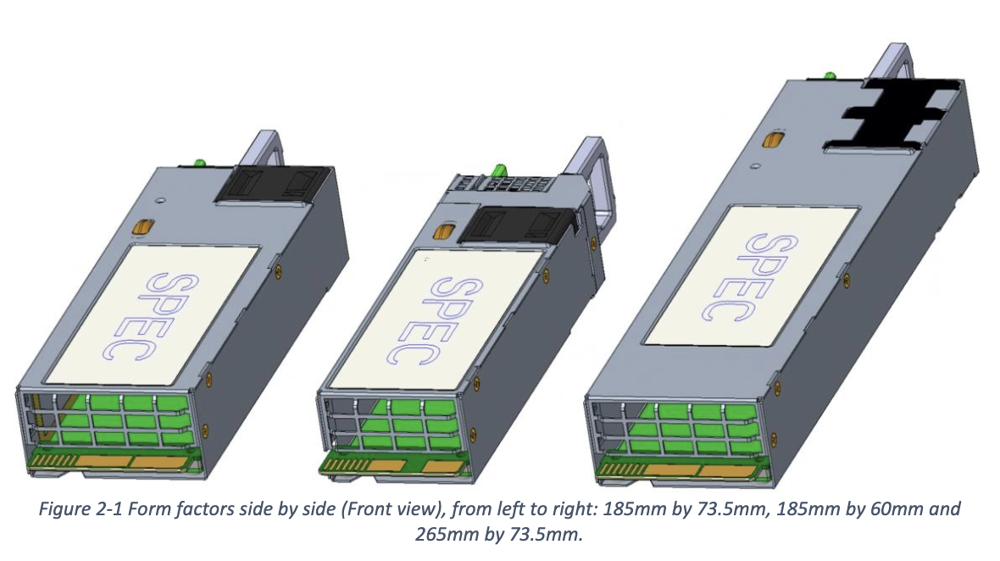

# 服务器电源

## CRPS

Common Redundant Power Supply

Form factor:

- 185mm by 73.5mm
= 185mm by 60mm
- 265mm by 73.5mm

<figure markdown>
  { width="400" }
  <figcaption>CRPS Form Factor（图源 <a href="https://www.opencompute.org/projects/server/mhs/dc-mhs-specs-and-designs/">M-CRPS Base Specification</a> Figure 2-1）</figcaption>
</figure>

Pinout:

- A1-A9: GND
- A10-A18: +12V
- A19(S1): PMBus SDA 
- A20(S2): PMBus SCL
- A21(S3): PSON#，电源的输入信号，控制供电开启或关闭
- A22(S4): SMBAlert#，电源的输出信号，代表电源出了问题
- A23(S5): Return Sense / PS_KILL
- A24(S6): Remote Sense
- A25(S7): PWOK，电源的输出信号，代表电源正常工作
- B1-B9: GND
- B10-B18: +12V
- B19(S8): SMBus Address A0
- B20(S9): SMBus Address A1
- B21(S10): +12VSB
- B22(S11): Cold Redundancy Bus
- B23(S12): 12V load share bus
- B24(S13): Imon，电源的输出信号，代表输出的电流大小
- B25(S14): VINOK，电源的输出信号，代表电源输入电压在正常范围

Reference:

- <https://www.gpupartner.com/reference/crps>
- <https://www.opencompute.org/wiki/Server/DC-MHS>
- <https://drive.google.com/file/d/1-KDyCqRdAEQ8gKFOIm88_ixXDWo6drYx/view>
